# Pestana Estúdio 🎸

App gratuito para iPhone, **sem anúncios**, para quem toca: afinador, acordes, metrônomo, um **estúdio de gravação em camadas**, um **modo treino** com separação de instrumentos por IA, que roda no próprio celular, e um **Loop** para tocar ao vivo.

<p align="center">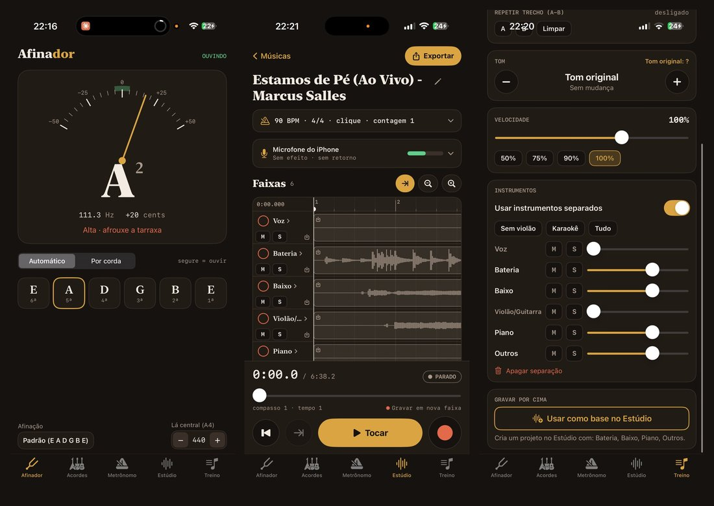</p>

## 💛 Apoie o projeto

**O Pestana Estúdio é e sempre será gratuito.**

Se o app te ajudou e você tiver condições, pode apoiar com uma doação de qualquer valor via Pix:

**Chave Pix (aleatória):** `63053aa4-cbad-4c78-b92c-8ba3082d83ca`

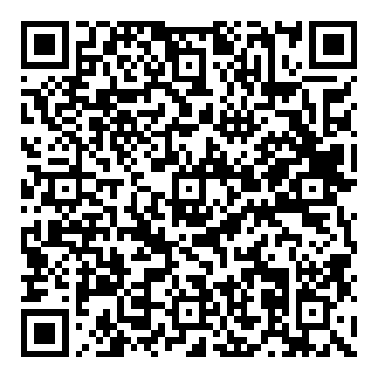

<details>
<summary>Pix copia e cola</summary>

```
00020126580014br.gov.bcb.pix013663053aa4-cbad-4c78-b92c-8ba3082d83ca5204000053039865802BR5915PESTANA ESTUDIO6014RIO DE JANEIRO62070503***63044F71
```

</details>

A doação é voluntária e não dá direito a recursos extras nem a suporte. É só um incentivo para eu continuar desenvolvendo o app e novos projetos. Mesmo com ajuda de IA, existem custos, como as assinaturas das ferramentas. Obrigado!

---

## Sumário

- [Instalação](#instalação)
- [Android (em desenvolvimento)](#android-em-desenvolvimento)
- [Afinador](#afinador)
- [Acordes](#acordes)
- [Metrônomo](#metrônomo)
- [Estúdio](#estúdio)
- [Treino](#treino)
- [Loop](#loop)
- [Usando na horizontal](#usando-na-horizontal)
- [Perguntas frequentes](#perguntas-frequentes)

---

## Instalação

O app não está na App Store. Ele é distribuído como arquivo **.ipa**, que você instala assinando com o seu próprio Apple ID.

1. Baixe o **PestanaEstudio.ipa** mais recente: [**⬇️ baixar a última versão**](../../releases/latest/download/PestanaEstudio.ipa) (ou veja todas em [Releases](../../releases)).
2. Instale com uma destas ferramentas:
   - **[Sideloadly](https://sideloadly.io/)** (Windows ou Mac): conecte o iPhone no cabo, arraste o .ipa, informe seu Apple ID e clique em *Start*.
   - **LiveContainer** ou **AltStore**: abra o .ipa por eles.
3. Na primeira vez, se o iPhone pedir, vá em **Ajustes › Geral › VPN e Gerenciamento de Dispositivos** e confie no seu Apple ID.
4. Com Apple ID gratuito, a assinatura vale **7 dias**. Depois disso é só reinstalar por cima: **suas músicas e gravações não se perdem**.

### Atualizações automáticas (AltStore ou SideStore)

Com o **[SideStore](https://sidestore.io)** ou o **[AltStore](https://altstore.io)**, adicione a fonte do Pestana Estúdio. Assim você instala o app e recebe as atualizações com um toque, sem baixar o .ipa de novo:

```
https://github.com/2d87h5jcdz-hub/PestanaEstudio/releases/latest/download/source.json
```

No app, vá em **Fontes › +**, cole o endereço acima e instale o **Pestana Estúdio**. O SideStore também renova a assinatura de 7 dias pelo próprio iPhone, sem precisar do computador depois da primeira instalação.

> Se o app pedir acesso ao microfone, permita. Ele é usado para afinar e gravar. Nada sai do seu iPhone sem você compartilhar.

---

## Android (em desenvolvimento)

A versão para Android fica na pasta [`android/`](android/) (Kotlin + Jetpack Compose; o Estúdio usa C++ com Oboe). Ela ainda **não tem Release**: os APKs de teste saem pelo GitHub Actions.

| Aba | Android |
| --- | --- |
| Afinador, Acordes, Metrônomo | ✅ prontos |
| Treino (tom, velocidade, loop A-B, separação por IA) | ✅ pronto — o modelo de IA (~115 MB) é baixado na primeira separação |
| Estúdio (gravação em camadas, efeitos, amp NAM, afinação da voz) | 🚧 **em desenvolvimento** — as telas e os efeitos funcionam, mas o som gravado pelo microfone ainda sai ruim em alguns aparelhos |

Onde o guia abaixo diz "app Arquivos", no Android é o seletor de arquivos do celular.

No Android não há a limitação de 7 dias do iPhone: o app é um **.apk** comum, instalado uma vez e pronto.

1. Abra a aba [**Actions › Gerar APK (Android)**](../../actions/workflows/android.yml) e entre na execução mais recente com ✅ (é preciso estar logado no GitHub).
2. No fim da página, em **Artifacts**, baixe **PestanaEstudio-apk** (vem um .zip; dentro está o `PestanaEstudio.apk`).
3. Passe o .apk para o celular (cabo, Google Drive, WhatsApp para você mesmo…) e toque nele.
4. Na primeira vez, o Android pede para **permitir a instalação de apps desta fonte** (o navegador ou o gerenciador de arquivos que abriu o .apk). Permita e volte para instalar.
5. Versões novas instalam **por cima** da anterior, sem perder seus ajustes.

> O Google Play Protect pode avisar que o app é "desconhecido" (ele não vem da Play Store). Toque em **Mais detalhes › Instalar assim mesmo**.

---

## Afinador

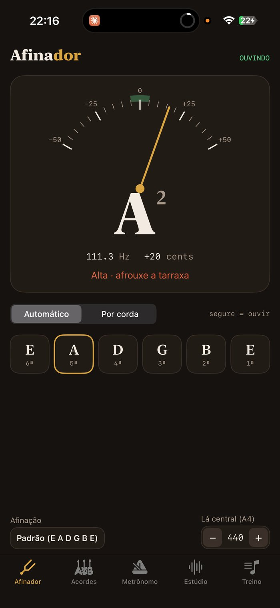

- Toque uma corda: o ponteiro mostra se está **baixa** (esquerda) ou **alta** (direita). No centro, fica verde: **afinada ✓**.
- **Automático** detecta sozinho qual corda você está tocando. **Por corda** deixa você escolher a corda tocando nela.
- **Segure uma corda** para ouvir a nota de referência.
- Embaixo você escolhe a **afinação** (padrão, drop D, meio tom abaixo…) e o **Lá central** (A4 = 440 Hz por padrão).

---

## Acordes

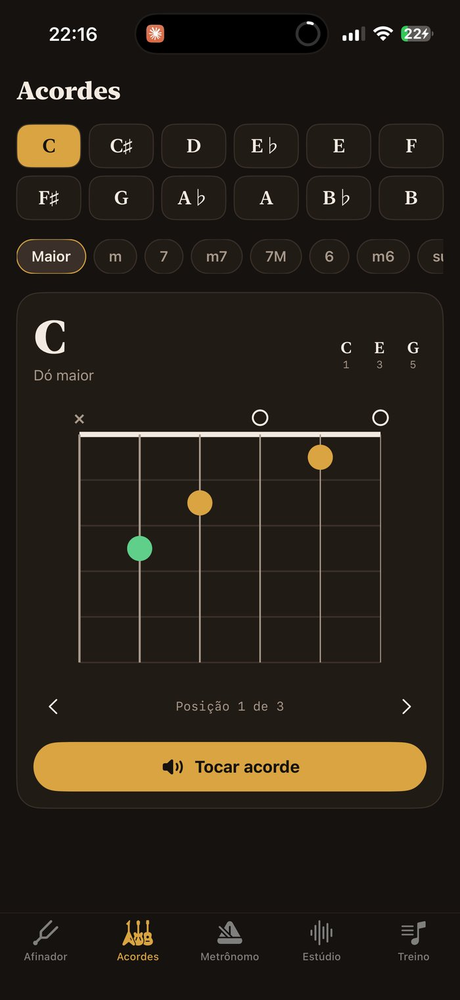

- Escolha a **nota** (Dó, Ré, Mi…) e o **tipo** (maior, menor, com sétima…). O desenho mostra onde colocar os dedos.
- Deslize o desenho para o lado para ver outras posições do mesmo acorde.
- Toque em **Tocar acorde** para ouvir como ele deve soar.

---

## Metrônomo

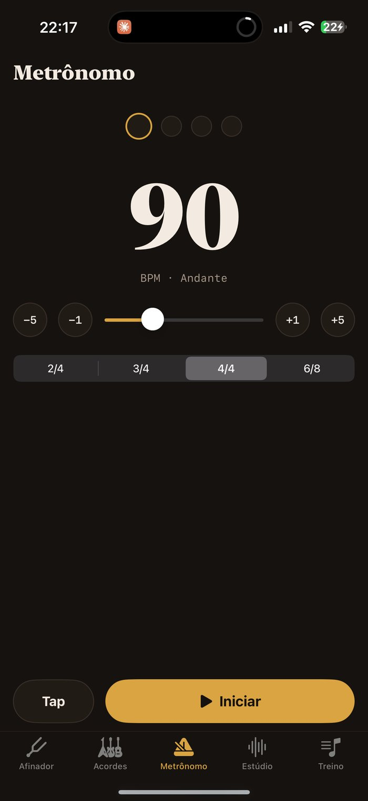

- Ajuste o **BPM** pelos botões ou pela barra, ou toque em **Tap** no ritmo da música para ele descobrir o andamento.
- Escolha o **compasso** (2/4, 3/4, 4/4, 6/8…). O primeiro tempo é acentuado.
- Toque em **Iniciar** para começar.

---

## Estúdio

O Estúdio grava **em camadas**: você grava o violão, depois grava a voz por cima ouvindo o violão, depois um solo, e assim por diante. No fim, exporta tudo misturado.

### 1. Criar uma música

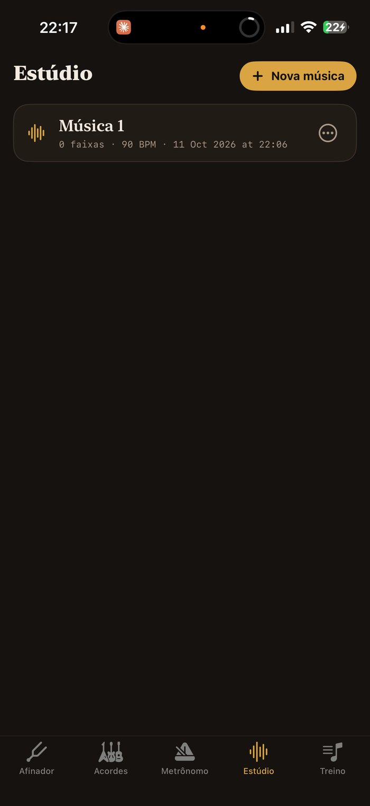

Toque em **Nova música** e dê um nome. Cada música é um projeto com as suas faixas. Para renomear ou apagar, use o menu **⋯** da música.

### 2. Ajustes da música e entrada

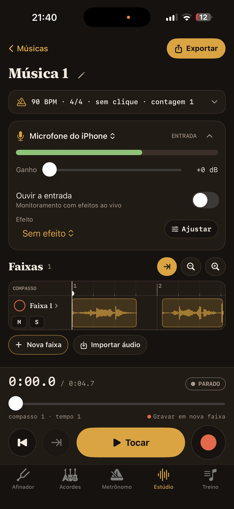

- **BPM, compasso, clique e contagem**: toque na barra para abrir. Com o clique ligado, você ouve o metrônomo enquanto grava, mas ele **não entra na gravação**. A contagem dá 1 ou 2 compassos antes de começar a gravar.
- **Entrada**: escolha de onde vem o som (**Microfone do iPhone**, microfone do fone ou interface USB) e ajuste o **Ganho** se a captação estiver baixa. A barra verde mostra o nível. Toque alto, mas sem encostar no fim.
- **Ouvir a entrada**: escute o que está sendo captado, com efeito ao vivo (violão aço, nylon, voz, guitarra…). **Use fone de ouvido**, senão vira microfonia.

### 3. Faixas e linha do tempo

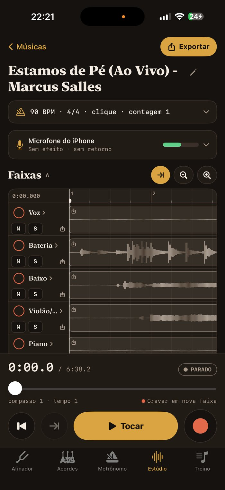

- Cada linha é uma **faixa**, e os blocos dourados são os trechos gravados, com a forma de onda.
- **Nova faixa** cria uma faixa vazia, que já fica **armada** (bolinha vermelha cheia). A próxima gravação entra nela.
- Toque na **bolinha vermelha** de uma faixa para armar ou desarmar. Sem nenhuma armada, cada gravação cria uma faixa nova.
- **M** deixa a faixa muda, **S** faz solo (só ela toca) e **FX** liga/desliga de uma vez todos os efeitos e a afinação da faixa (os ajustes ficam guardados). Toque no **nome** da faixa para volume, pan, efeitos, renomear e apagar.
- **Importar áudio** traz uma base, uma guia ou um playback do app Arquivos como faixa.

### 4. Posicionar a cabeça de reprodução

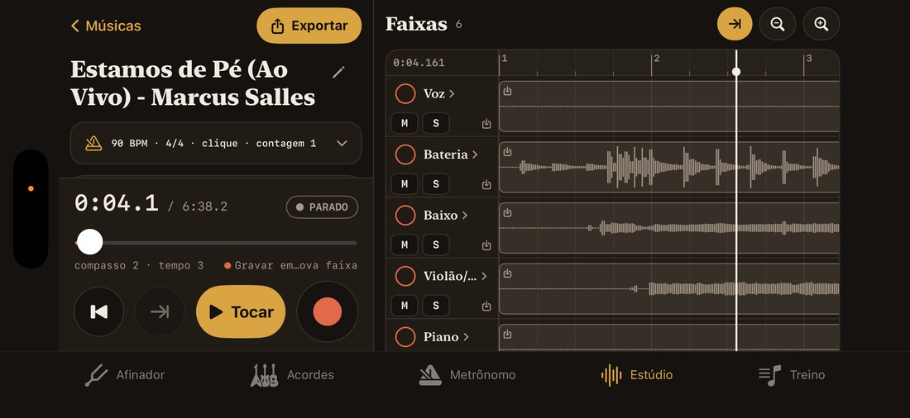

- **Deslize o dedo na régua** (a faixa de cima, com os números dos compassos) para levar a cabeça até o ponto desejado.
- **Arraste nas ondas** para andar pela música sem mexer na cabeça. **Um toque** nas ondas leva a cabeça até ali.
- **Pinça** (dois dedos) ou as **lupas** dão zoom. De longe você vê a música inteira; de perto, a régua mostra décimos e **milissegundos**.
- O canto esquerdo da régua mostra a posição exata, por exemplo `0:12.345`.
- O botão **⇥** leva a cabeça até o fim da faixa armada, para **continuar de onde parou**.

### 5. Gravar

- Toque no **botão vermelho**. Se a contagem estiver ligada, ela toca antes, e então a gravação começa na posição da cabeça.
- Gravar no meio de uma faixa que já tem áudio **substitui só aquele trecho** (*punch-in*). O resto da faixa fica intacto.
- **Tocar** reproduz tudo. **⏮** volta ao começo.

### 6. Editar trechos

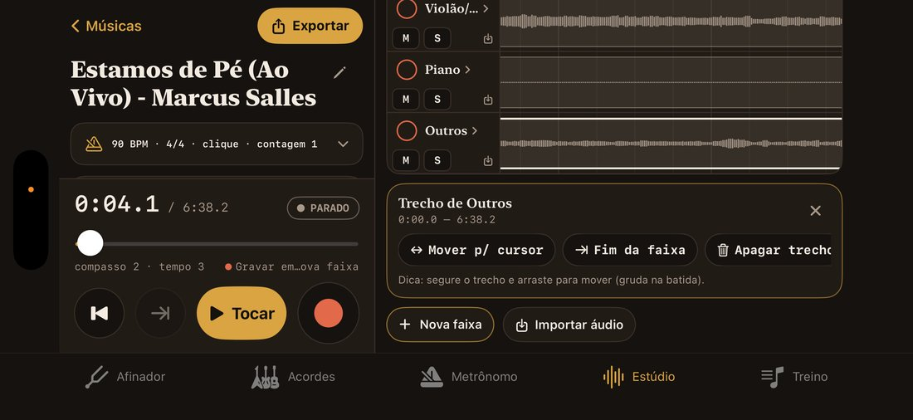

Toque num trecho para selecioná-lo. Aparecem as opções:

- **Segure e arraste** o trecho para movê-lo. Ele gruda na batida.
- **Mover p/ cursor** leva o trecho para onde está a cabeça.
- **Fim da faixa** e **Apagar trecho**.

### 7. Efeitos

<!-- PRINT: docs/prints/09-estudio-efeitos.png -->

Cada faixa tem seus efeitos, e os mesmos efeitos funcionam ao vivo em **Ouvir a entrada**:

- **Presets prontos:** Violão aço, Violão nylon, Voz, Guitarra limpa, Guitarra drive, **Crunch, Distorção pesada, Fuzz, Solo, Limpa com chorus, Flanger anos 80, Phaser e Tremolo**.
- **Ajuste manual:** noise gate, equalizador, compressor, drive (estilos distorção, crunch, funk e fuzz), **modulação** (chorus, flanger, phaser e tremolo), delay e reverb.

#### Afinação automática (voz)

Na tela de efeitos de uma faixa, ligue **Afinação automática**. O app analisa a voz gravada e leva cada nota para o lugar certo de forma **sutil**: mantém o vibrato e a expressão, para não soar como efeito.

- **Tom:** automático (descoberto pela própria voz) ou escolhido à mão, com escala maior, menor ou cromática.
- **Intensidade:** começa em 80%. Mais baixo soa mais natural; 100% leva cada nota exatamente para o lugar.
- O processamento roda em segundo plano depois da gravação. A **gravação original não muda**: dá para desligar ou ajustar quando quiser.

#### Amplificador (IA) — Neural Amp Modeler

O app roda modelos **.nam** do [Neural Amp Modeler](https://github.com/sdatkinson/neural-amp-modeler), que imitam amplificadores e pedais reais com IA.

1. Baixe capturas gratuitas em **[tone3000.com](https://www.tone3000.com)**. Prefira as marcadas como **full rig**, que já incluem a caixa do amplificador.
2. Em **Efeitos › Amplificador (IA) › Modelo › Importar arquivo .nam…**, escolha o arquivo.
3. Deixe o **Drive em 0** (o amplificador já distorce) e ajuste **Entrada** (ganho) e **Saída** (volume).

Se ouvir estalos tocando ao vivo, use capturas **lite** ou **feather**, que são mais leves para o iPhone. Os modelos ficam em Arquivos › Pestana › Amps.

### 8. Exportar

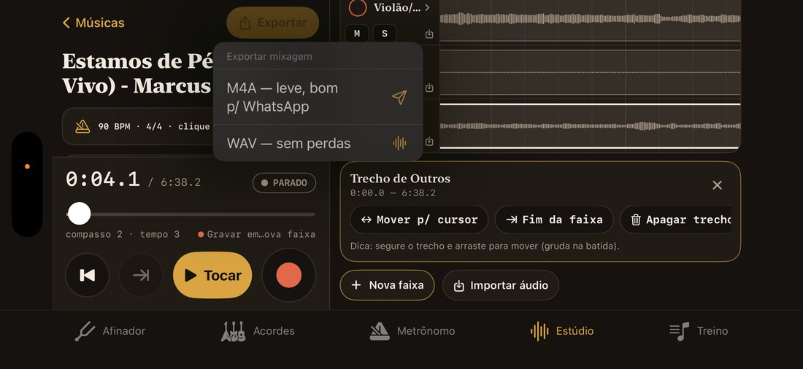

Toque em **Exportar**, escolha **M4A** (menor, bom para WhatsApp) ou **WAV** (qualidade máxima) e compartilhe ou salve no Arquivos.

---

## Treino

O modo Treino é para **estudar músicas**: mudar o tom, desacelerar, repetir um trecho e até tirar o violão da música para você tocar no lugar.

### 1. Importar uma música

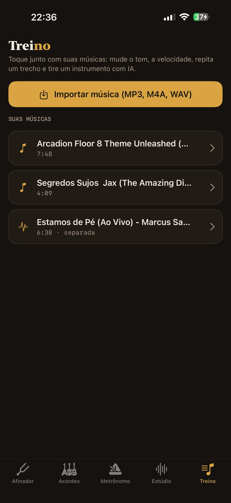

Toque em **Importar música (MP3, M4A, WAV)** e escolha o arquivo no app Arquivos.

### 2. Tom, velocidade e repetição

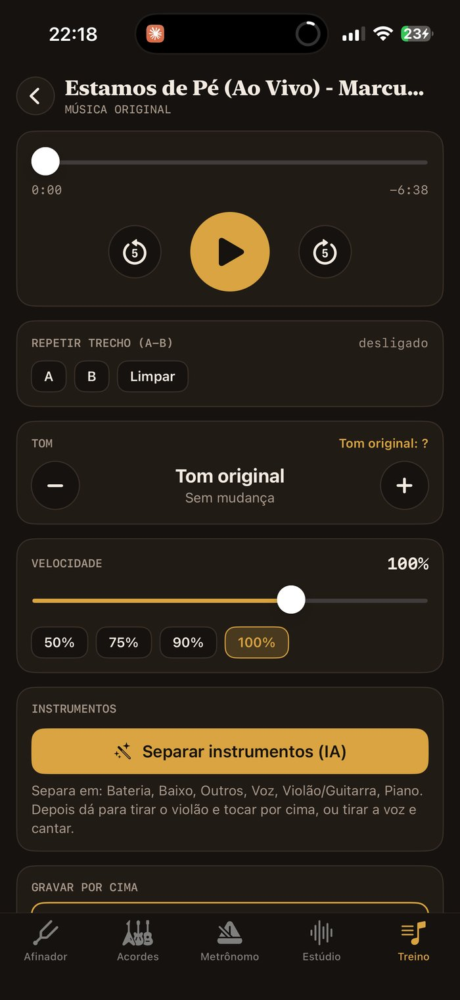

- **Tom**: suba ou desça em semitons. O app mostra como os acordes mudam, por exemplo "um acorde de C vira D".
- **Velocidade**: desacelere sem mudar o tom, ótimo para pegar solos.
- **Repetir trecho (A-B)**: marque o ponto **A**, depois o **B**, e o trecho fica em loop.

### 3. Separar instrumentos (IA)

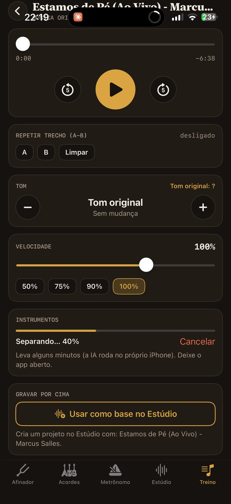 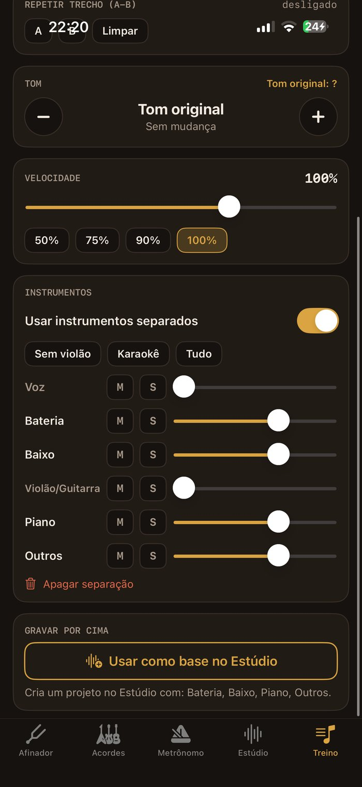

- Toque em **Separar instrumentos (IA)**. Leva alguns minutos, porque a IA roda **no próprio iPhone**, sem internet. Deixe o app aberto.
- Depois, use os atalhos **Karaokê** (sem voz), **Sem violão**, **Tudo**, ou ajuste cada instrumento (voz, bateria, baixo, guitarra, piano, outros).
- **Usar como base no Estúdio** cria um projeto no Estúdio com a música (ou os instrumentos separados) para você gravar por cima.

---

## Loop

Uma pedaleira de loop para tocar ao vivo: grave uma base, feche o loop e vá somando camadas por cima enquanto toca.

1. Toque no botão redondo da **Faixa 1** para gravar. Toque de novo para fechar o loop: ele já começa a tocar sem parar. Esse primeiro trecho define o **ciclo**.
2. Grave as outras faixas do mesmo jeito. Elas seguem o ciclo da primeira. Antes de gravar, escolha **×1, ×2 ou ×4** para uma faixa mais longa (por exemplo, uma frase que só se completa em dois ciclos).
3. Tocar no botão de uma faixa que já toca **grava por cima** (uma camada nova). O botão ↶ desfaz a última camada.
4. O alto-falante de cada faixa para ou volta a tocar só ela. O botão grande no topo para ou toca tudo.
5. Em **Efeitos**, escolha o som (drive, amp, delay, reverb…). O que você toca e o que é gravado saem com esse som.

**Loop automático (mãos livres):** ligue **Loop automático** e escolha o BPM (ou use o **Tap**), o compasso e quantos compassos o ciclo tem. Toque no botão da faixa: a gravação começa depois de um compasso de contagem (ou na primeira nota, com **Ao tocar**) e o loop fecha sozinho no tempo exato. Gravar por cima fica **armado** e entra no começo do próximo ciclo, gravando uma volta. Com **Gravar as faixas em sequência**, cada faixa vazia grava sozinha no ciclo seguinte: é só tocar.

**Pedal Bluetooth:** pedais de virar página funcionam como teclado. → (ou espaço) aperta o botão da faixa selecionada (com borda dourada), ← troca de faixa e segurar ← para ou toca tudo. Num teclado, as teclas 1 a 6 apertam cada faixa e Apagar desfaz.

> Use fone ou uma interface de áudio. Sem fone, o microfone capta o som do alto-falante e ele entra nas camadas. Se as camadas ficarem levemente atrasadas ou adiantadas, ajuste a **Compensação de atraso** em Ajustes.

---

## Usando na horizontal


Todas as telas funcionam com o iPhone deitado. No Estúdio, a linha do tempo ganha a tela toda à direita, e os controles de gravação ficam à esquerda.

---

## Perguntas frequentes

**O app parou de abrir.**
Passaram os 7 dias da assinatura gratuita. Reinstale o .ipa por cima com o Sideloadly; seus projetos continuam lá.

**A gravação ficou baixa com fone.**
Com fone conectado, o iPhone troca para o microfone do fone. Em **Entrada**, escolha **Microfone do iPhone** ou aumente o **Ganho**.

**Ouço um atraso quando escuto a entrada.**
Fones Bluetooth têm atraso. Para gravar ouvindo a entrada, prefira fone com fio.

**Onde ficam meus arquivos?**
No app **Arquivos › No meu iPhone › Pestana**. Dá para copiar e fazer backup por lá.

---

## Para desenvolvedores

O .ipa é gerado pelo GitHub Actions (workflow **Gerar IPA**, em macOS) a partir do `project.yml` (XcodeGen). O .ipa sai sem assinatura, e a ferramenta de instalação faz a assinatura. O modelo de separação (Demucs) é convertido para Core ML pelo workflow `demucs-model.yml`.

O amplificador usa o [NeuralAmpModelerCore](https://github.com/sdatkinson/NeuralAmpModelerCore) (MIT), com [Eigen](https://eigen.tuxfamily.org) (MPL2) e [nlohmann/json](https://github.com/nlohmann/json) (MIT), incluídos em `Vendor/` com as licenças. Uma Release nova sai sozinha quando o `main` recebe uma versão nova em `MARKETING_VERSION` (`project.yml`), usando as notas em `docs/release-notes/`.

## Licença

O Pestana Estúdio é **gratuito e não pode ser vendido**. O código está sob a **[PolyForm Noncommercial 1.0.0](LICENSE)**: você pode ver, estudar, modificar e compartilhar o código para fins **não comerciais** (uso pessoal, estudo, igrejas, escolas, projetos sem fins lucrativos). **Vender o app, cobrar por ele ou usá-lo comercialmente não é permitido.**

O nome **"Pestana Estúdio"** e o logo não fazem parte da licença: versões modificadas precisam usar outro nome e outro ícone.

Os componentes de terceiros mantêm as licenças originais; veja [THIRD-PARTY-NOTICES.md](THIRD-PARTY-NOTICES.md).
